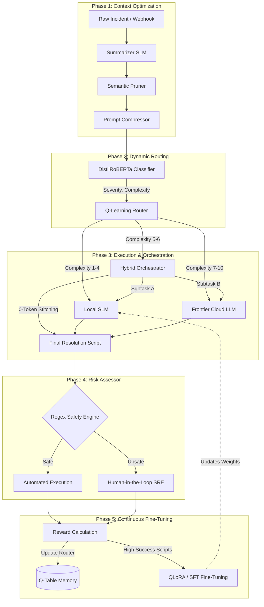
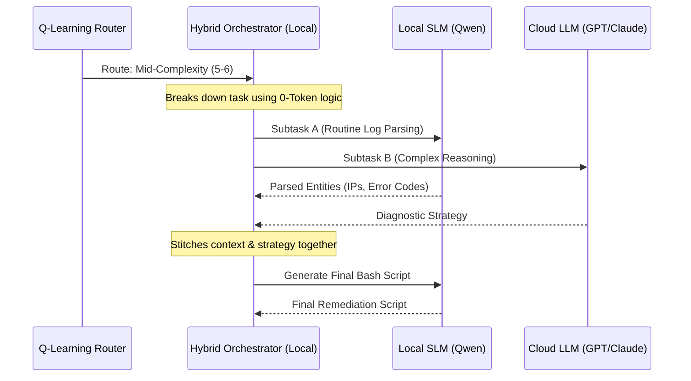

# Self-Healing Token-Aware Multi-Agent Architecture

An enterprise-grade AIOps system designed to autonomously resolve infrastructure incidents (Kubernetes, AWS, Databases) while mathematically minimizing Cloud LLM token costs through a Reinforcement Learning router and Hybrid Orchestration.

## 🚀 The 5-Phase Architecture

### Phase 1: Context Optimization
Reduces incoming webhook and log bloat by up to 85% before it ever reaches an LLM.
- **Summarizer:** Cleans noisy Slack chat histories.
- **Semantic Pruner (MiniLM):** Removes irrelevant log lines.
- **Prompt Compressor (LLMLingua):** Compresses token payload while maintaining semantic meaning.

### Phase 2: Dynamic Q-Learning Router
Uses an offline-pre-warmed Reinforcement Learning matrix to route incidents based on their evaluated state.
- **Classifier (nli-distilroberta-base):** Grades the incident's Severity (1-10) and Complexity (1-10).
- **Q-Table Router:** Selects the most cost-efficient execution path (SLM, LLM, or Hybrid).

### Phase 3: Execution & Hybrid Orchestration 🌟 (NEW)
The execution engine now supports a novel **Hybrid Orchestrator**. 
For borderline complex incidents (Complexity 5-6), the local SLM breaks the task into pieces at **0-token cost**:
- **Routine Subtasks** (e.g., parsing Datadog IPs) are handled by the Local SLM.
- **Complex Subtasks** (e.g., deep diagnostic reasoning) are sent to the Cloud LLM.
The SLM then stitches the results together to generate the final remediation script, achieving frontier-level accuracy at a fraction of the cost.

### Phase 4: Risk Assessor & Human-in-the-Loop
Before any script runs, it passes through a strict Regex Safety Engine. Destructive commands (`rm -rf`, `iptables -F`, `kubectl delete ns`) are immediately flagged and sent to a Human SRE portal.

### Phase 5: Continuous Fine-Tuning 🌟 (NEW)
A closed-loop learning system. Highly successful local SLM resolutions (Reward > 10.0) are buffered into a proprietary JSONL dataset. Periodically, the system triggers **QLoRA** fine-tuning to permanently upgrade the local SLM's weights, continuously reducing reliance on Cloud LLMs.

---

## 📐 Architecture Diagrams

### High-Level Architecture Flow

### Hybrid Orchestration Deep-Dive

---

## 📊 Academic Datasets & Benchmarks
This repository is backed by rigorous, synthetic DevSecOps datasets generated via LLM-as-a-Data-Annotator methodologies to bypass enterprise NDAs:
- `golden_benchmark_test_set_EXPANDED.json`: 15 unseen incidents for strict Train/Test evaluation.
- `q_table_prewarm_history_EXPANDED.json`: 300 State-Action-Reward transitions solving the RL "Cold Start" problem.
- `master_aiops_dataset_FINAL.json`: 75 training examples covering Phase 1-5 requirements.

## 🛠️ Stack
- **Frontend:** React, TailwindCSS, ReactMarkdown
- **Backend:** FastAPI, Python 3.10
- **Models:** Ollama (qwen2.5:1.5b local), LangChain
- **Routing:** Tabular Q-Learning, DistilRoBERTa
