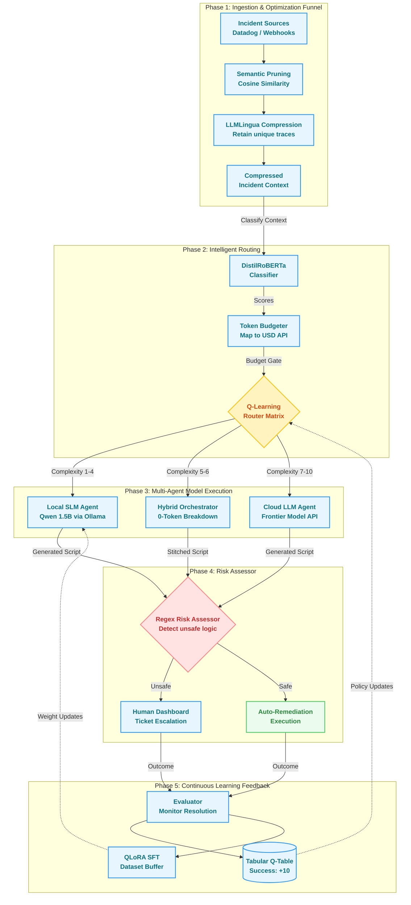

# Token-Aware Multi-Agent Architecture for Autonomous Site Reliability Engineering

## Abstract
This repository contains the source code, training datasets, and evaluation frameworks for a Token-Aware Multi-Agent Architecture designed to autonomously remediate enterprise infrastructure incidents. The system minimizes cloud Large Language Model (LLM) API costs by routing incidents through a Reinforcement Learning-based decision matrix, shifting routine workloads to local Small Language Models (SLMs) and reserving frontier models for high-complexity diagnostic reasoning.

## What is implemented, and how it was evaluated

Read this before the architecture below. It describes the full design, but not every part is built, and the benchmark is a **simulation**.

| Component | Status |
|---|---|
| Semantic pruning (sentence-transformer similarity) | Implemented. The benchmark runs it, but token counts after compression come from an assumed ratio (see below). |
| LLMLingua compression | Implemented in `src/optimization/compressor.py`. **Not run in the benchmark.** |
| Severity/complexity classifier (DistilRoBERTa) | Code loads a fine-tuned model if one is provided. **No trained model is included.** Without one it falls back to a fixed default, and the benchmark uses the dataset's labelled severity and complexity instead. |
| Tabular Q-learning router | Implemented and used in the benchmark, trained on the simulated rewards. |
| Local / cloud / hybrid execution | Code paths exist. **The benchmark does not call any model.** |
| AST-canonicalizing safety gate | Implemented and evaluated on 500 generated scripts (37 malicious, 463 safe) that the author wrote. |
| Phase 5 QLoRA / classifier fine-tuning | Design only. `phase5_finetuning.py` logs examples to a buffer and trains nothing. |

**How `run_500_benchmark.py` scores routing.** For each incident and policy, success is a random draw from fixed, assumed probabilities. A local model succeeds 97% of the time at complexity 1–3, 42% at 4–6 and 5% at 7–10; the cloud model 95%; the hybrid path 97% / 94% / 65%. Cost is the estimated token count multiplied by list API prices. Compressed tokens are `raw × (0.32 + 0.05 × pruned_ratio)`, an assumed LLMLingua-like ratio. The draws are not seeded, so results vary a little from run to run.

So the cost and success figures show how the router behaves **if** these assumptions hold. They are not measurements of real models fixing real incidents. Validating them against real model runs is the main open work.

## System Architecture

The proposed architecture operates across five discrete phases, ensuring token efficiency, deterministic safety, and continuous policy improvement.

### Phase 1: Ingestion and Optimization
The optimization funnel mitigates context bloat from raw webhook payloads and stack traces. 
- **Semantic Pruning:** A local sentence transformer calculates cosine similarity across log chunks, discarding redundant traces.
- **Prompt Compression:** The LLMLingua framework compresses the remaining context, achieving significant payload reduction while retaining critical error signatures.

### Phase 2: Intelligent Routing
The router dynamically determines the most cost-effective execution path without executing external API calls.
- **Incident Classifier:** A fine-tuned DistilRoBERTa regression model evaluates the compressed context to predict Severity (1-10) and Complexity (1-10).
- **Token Budgeter:** Maps the severity score to a strict USD budget.
- **Q-Learning Matrix:** A tabular Reinforcement Learning agent queries the (Severity, Complexity) state against historical policies to output an optimal routing action (Local SLM, Cloud LLM, or Hybrid Orchestration).

### Phase 3: Multi-Agent Execution
Based on the routing decision, the system delegates the resolution task.
- **Local SLM:** Utilizes Qwen 1.5B (via Ollama) for low-complexity tasks at zero API cost.
- **Cloud LLM:** Engages frontier models for high-complexity, cross-service diagnostic reasoning.
- **Hybrid Orchestration:** For borderline incidents, the system breaks the context down locally at zero cost. The Local SLM parses routine boilerplate data, while the Cloud LLM processes specific diagnostic questions. The Local SLM subsequently stitches the final resolution script.

### Phase 4: Risk Assessment and Execution
To prevent destructive autonomous actions, generated remediation scripts must pass through a strict regulatory gate.
- **Regex Safety Engine:** Scans scripts against a curated blacklist of destructive commands (e.g., recursive deletions, firewall flushes). Unsafe scripts are blocked and escalated to a human-in-the-loop dashboard.
- **Auto-Remediation:** Scripts that pass the safety engine are executed automatically.

### Phase 5: Continuous Learning Feedback
The system operates on a closed-loop feedback mechanism to continuously improve routing logic and generation accuracy.
- **Policy Updates:** Successful resolutions generate positive rewards (+10) that update the Q-Table weights via the Bellman equation, optimizing future routing paths.
- **QLoRA Fine-Tuning:** High-reward execution traces are buffered into a proprietary dataset for offline Parameter-Efficient Fine-Tuning (PEFT) of the local SLM, reducing long-term reliance on the Cloud LLM.

---

## Architectural Flow Diagram



---

## Experimental Datasets and Benchmarks

To address the privacy limitations of enterprise infrastructure telemetry, this repository relies on synthetic datasets generated via LLM-as-a-Data-Annotator methodologies. This ensures rigorous architectural evaluation without compromising proprietary architectures or violating non-disclosure agreements.

- `master_aiops_dataset_FINAL.json`: The core training dataset containing 75 high-fidelity synthetic incidents, utilizing multi-cloud failure states to fine-tune the Phase 2 classifier and Phase 3 SLM.
- `q_table_prewarm_history_EXPANDED.json`: A programmatic dataset of 300 state-action-reward transitions designed to pre-warm the Q-Learning router, bypassing the catastrophic exploration penalty inherent in uninitialized tabular reinforcement learning.
- `golden_benchmark_test_set_EXPANDED.json`: A strict holdout dataset of 15 highly complex, unseen incidents utilized exclusively for final performance and ablation studies.

## Testing and Continuous Integration

This architecture maintains high engineering reliability through a comprehensive unit testing suite.
- Uses `pytest` with mocked HuggingFace model endpoints to allow rapid testing without large local weights.
- Features a GitHub Actions Continuous Integration (CI) pipeline that automates the verification of the router, budgeter, and classifier logic upon every branch update.

---

## Reproducing the results

The 500-incident benchmark is synthetic, because real enterprise incident data is private. Routing outcomes are simulated (see "What is implemented, and how it was evaluated").

```bash
python -m venv venv && venv/bin/pip install -r token-aware-sre/requirements.txt matplotlib
venv/bin/python create_500_benchmark.py      # writes golden_benchmark_500_incidents.json (already included)
venv/bin/python run_500_benchmark.py         # writes benchmark_500_results.json
venv/bin/python generate_figures_500.py      # writes fig2/fig3/fig6 *_500.png and .svg
venv/bin/python run_experiments_and_log.py   # writes evaluation_logs/*.json
```

`run_500_benchmark.py` runs offline (`HF_HUB_OFFLINE=1`), so download the sentence-transformer model once beforehand.

Results of one simulation run (`benchmark_500_results.json`), under the assumptions described above:

| Metric (simulated) | Result |
|---|---|
| Estimated cloud cost, Q-learning router vs context-optimized cloud-only | $0.630 vs $1.731 (about 64% lower) |
| Simulated resolution success | 95.6% (cloud-only: 94.6%; FrugalGPT-style cascade: 96.2% at $1.089) |
| Safety gate on the author's 500-script test set | 37/37 malicious blocked, 0/463 false alarms (regex baseline: 59.5% recall) |

Presented as "Self-Healing Token-Aware Multi-Agent Architecture for Cost-Effective SRE Automation", which won the **Best Paper Award at IC-SIT 2026** (IEEE Student Research Symposium, Silicon University, September 2026). The paper has not been published yet, so it is not in this repository.
