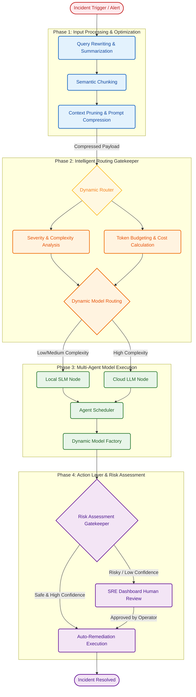

# Self-Healing Token-Aware Multi-Agent Architecture

## Objective

The objective of this project is to provide an advanced Site Reliability Engineering (SRE) automation framework. It aims to ingest high-volume, noisy incident alerts and autonomously remediate them using a multi-agent system. 

The core differentiator of this architecture is its token-awareness. Large Language Models (LLMs) incur significant API costs, and feeding them unoptimized raw logs is inefficient. This architecture introduces a highly optimized pipeline that shrinks, summarizes, and prunes incident data locally before securely routing it to either a local Small Language Model (SLM) or a cloud-based Frontier LLM, depending on calculated incident complexity and severity.

## Goals

1. Cost Efficiency: Reduce API costs by executing pre-processing, summarization, and trivial remediations on local hardware using SLMs, reserving cloud LLMs for complex, high-severity issues.
2. Token Optimization: Prevent context window exhaustion and save budget by aggressively compressing logs and chat histories while preserving semantic meaning.
3. Self-Healing and Auto-Remediation: Safely execute scripts and fix infrastructure issues autonomously, utilizing a risk assessor gatekeeper.
4. Dynamic Architecture: Utilize a thread-safe FastAPI backend that dynamically integrates model factories and agent schedulers to adapt to varying LLM providers without hardcoded constraints.

## Project Phases

### Phase 1: Input Processing and Optimization

This phase acts as the ingestion point. It heavily compresses chaotic data into a token-efficient payload.
- Query Rewriting: Normalizes raw logs or JSON webhooks into readable text.
- Semantic Chunking: Breaks large stack traces into safe, overlapping chunks.
- Context Pruning: Drops redundant log lines to preserve budget.
- Prompt Compression: Shrinks the payload further by removing non-essential tokens.

### Phase 2: Intelligent Routing Gatekeeper

This phase decides where the compressed payload should be routed.
- Global Dynamic Routing: The ingress point that distributes the payload based on internal policy weights.
- Severity and Complexity Analysis: Evaluates the incident to determine the risk level.
- Token Budgeting: Calculates maximum allowable API spend and token heuristic limits for the incident.
- Dynamic Model Routing: Decides whether to route the incident to a local SLM for low-complexity issues or a cloud LLM for high-complexity issues based on the calculated budget.

### Phase 3: Multi-Agent Model Execution

This phase handles the actual troubleshooting and remediation.
- Model Factory: Dynamically instantiates the correct model interfaces based on runtime configurations and routing decisions.
- Agent Scheduler: Coordinates tasks among specialized personas (e.g., Database Administrator, Network Engineer).
- Thread-Safe Execution: Executes heavy synchronous operations and model inferences within isolated threadpools to prevent ASGI event loop blocking.

### Phase 4: Action Layer and Risk Assessment

This phase evaluates and executes the generated solution.
- Action Assessment: Evaluates the generated solution for risk and confidence.
- Auto-Remediation: Safely executes fixes automatically for trusted scenarios.
- SRE Dashboard: Routes risky or destructive fixes to human operators for manual review, trace inspection, and execution approval.

## Architecture

## Continuous Learning and Feedback

The Reinforcement Learning mechanism connects the resolution layer back to the routing layer. After an incident is resolved, the system reviews the actions taken. The system computes a reward (if the issue was solved efficiently by an SLM) or a penalty (if the SLM failed and it had to be escalated). 

These rewards and penalties dynamically adjust the Q-Table weights inside the dynamic router. Over time, the router learns to trust the local SLM for specific classes of errors that previously required a cloud LLM, creating a continuously self-optimizing and increasingly cost-effective SRE architecture.
