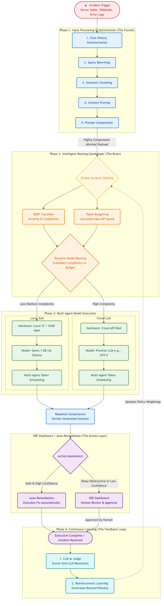

# Self-Healing Token Aware Multi-Agent Architecture

## Objective

The objective of this project is to create an advanced Site Reliability Engineering (SRE) automation framework. It aims to ingest massive, noisy incident alerts (like Datadog webhooks or Kubernetes stack traces) and autonomously remediate them using a multi-agent system. 

The core differentiator of this architecture is its Token Awareness. Large Language Models (LLMs) are expensive, and feeding them endless megabytes of raw logs is cost-prohibitive and inefficient. This architecture introduces a highly optimized funnel that shrinks, summarizes, and prunes incident data locally before securely routing it to either a local Small Language Model (SLM) or a cloud-based Frontier LLM, depending on complexity and budget.

## Goals

1.  Cost Efficiency: Drastically reduce API costs by executing pre-processing, summarization, and simple remediations on local hardware using SLMs, reserving cloud LLMs for complex, high-severity issues.
2.  Token Optimization: Prevent context window exhaustion and save budget by aggressively compressing logs and chat histories while preserving semantic meaning.
3.  Self-Healing and Auto-Remediation: Safely execute scripts and fix infrastructure issues autonomously when confidence is high.
4.  Continuous Learning: Implement a feedback loop that evaluates past resolutions and updates routing policy weights, allowing the system to learn when to trust local models versus cloud models.

## Project Phases

### Phase 1: Input Processing & Optimization (The Funnel)

This phase acts as the ingestion point. It heavily compresses chaotic data into a token-efficient payload.
-   Query Rewriting: Normalizes raw logs or JSON webhooks into readable text.
-   Chat History Summarization: Uses local models (like BART) to condense past troubleshooting context.
-   Semantic Chunking: Breaks large stack traces into safe, overlapping chunks.
-   Context Pruning: Uses Sentence Transformers to calculate cosine similarity, dropping redundant log lines.
-   Prompt Compression: Shrinks the payload further by dropping stopwords and filler tokens using LLMLingua.

### Phase 2: Intelligent Routing Gatekeeper (The Brain)

This phase decides where the compressed payload should go.
-   Global Dynamic Routing: The ingress point that distributes the payload based on internal policy weights.
-   BERT Classifier: Evaluates the severity and complexity of the incident.
-   Token Budgeting: Calculates maximum allowable API spend for the incident.
-   Dynamic Model Routing: Decides whether to route the incident to a local SLM (e.g., Qwen 1.5B) for low-complexity issues or a cloud LLM (e.g., GPT-4) for high-complexity issues.

### Phase 3: Multi-Agent Model Execution & Action Layer

This phase handles the actual troubleshooting and remediation.
-   Multi-Agent Scheduling: Coordinates tasks among specialized agents.
-   Action Assessment: Evaluates the generated solution for risk and confidence.
-   Auto-Remediation: Safely executes fixes automatically.
-   SRE Dashboard: Routes risky or destructive fixes to human operators for review and approval.

### Phase 4: Continuous Learning (The Feedback Loop)

This phase handles the Reinforcement Learning aspect.
-   LLM as a Judge: A highly capable LLM reviews the full incident resolution flow and scores the performance.
-   Reinforcement Learning: Generates a reward or penalty based on resolution time, accuracy, and cost.
-   Policy Weight Updates: The RL system feeds these updates back into the Global Dynamic Routing node in Phase 2. This continuous feedback loop teaches the Global Router which incidents can be safely handled by cheaper local SLMs in the future, optimizing long-term costs.

## Architecture and Flow

### Architecture Diagram

```mermaid
graph TD
    classDef trigger fill:#ffebee,stroke:#c62828,stroke-width:2px,color:#b71c1c,rx:5px,ry:5px
    classDef phase1 fill:#e3f2fd,stroke:#1565c0,stroke-width:2px,color:#0d47a1,rx:5px,ry:5px
    classDef phase2 fill:#fff3e0,stroke:#ef6c00,stroke-width:2px,color:#e65100,rx:5px,ry:5px
    classDef phase3 fill:#e8f5e9,stroke:#2e7d32,stroke-width:2px,color:#1b5e20,rx:5px,ry:5px
    classDef action fill:#f3e5f5,stroke:#6a1b9a,stroke-width:2px,color:#4a148c,rx:5px,ry:5px
    classDef feedback fill:#e0f7fa,stroke:#00838f,stroke-width:2px,color:#006064,rx:5px,ry:5px
    classDef global fill:#fff8e1,stroke:#fbc02d,stroke-width:2px,color:#f57f17,rx:5px,ry:5px

    A([Incident Trigger<br/>Server Spike, Webhook, Error Logs]):::trigger --> B
    
    subgraph Phase1 ["Phase 1: Input Processing & Optimization (The Funnel)"]
        B[1. Chat History Summarization]:::phase1 --> C[2. Query Rewriting]:::phase1
        C --> D[3. Semantic Chunking]:::phase1
        D --> E[4. Context Pruning]:::phase1
        E --> F[5. Prompt Compression]:::phase1
    end

    F --> |Highly Compressed Minimal Payload| G
    
    subgraph Phase2 ["Phase 2: Intelligent Routing Gatekeeper (The Brain)"]
        G{Global Dynamic Routing}:::global
        G --> H[BERT Classifier<br/>Severity & Complexity]:::phase2
        G --> I[Token Budgeting<br/>Calculates Max API Spend]:::phase2
        H --> J{Dynamic Model Routing<br/>Evaluates Complexity vs. Budget}:::phase2
        I --> J
    end
    
    J --> |Low/Medium Complexity| L_SLM
    J --> |High Complexity| C_LLM

    subgraph Phase3 ["Phase 3: Multi-Agent Model Execution"]
        subgraph Local ["Local SLM"]
            L_SLM[Hardware: Local i5 / 16GB RAM]:::phase3 --> L_Model[Model: Qwen 1.5B via Ollama]:::phase3
            L_Model --> L_Sched[Multi-Agent Token Scheduling]:::phase3
        end
        
        subgraph Cloud ["Cloud LLM"]
            C_LLM[Hardware: Cloud API Paid]:::phase3 --> C_Model[Model: Frontier LLM e.g., GPT-4]:::phase3
            C_Model --> C_Sched[Multi-Agent Token Scheduling]:::phase3
        end
    end

    L_Sched --> K
    C_Sched --> K
    
    K[Response Compression<br/>Shrinks Generated Solution]:::phase1 --> L{Action Assessment}:::action
    
    subgraph ActionLayer ["SRE Dashboard / Auto-Remediation (The Action Layer)"]
        L --> |Safe & High Confidence| M[Auto-Remediation<br/>Executes Fix Automatically]:::action
        L --> |Risky/Destructive or Low Confidence| N[SRE Dashboard<br/>Human Review & Approval]:::action
    end
    
    M --> O([Execution Complete / Incident Resolved]):::action
    N --> |Approved by Human| O
    
    subgraph Phase4 ["Phase 4: Continuous Learning (The Feedback Loop)"]
        O --> P[1. LLM as Judge<br/>Scores SLM/LLM Resolution]:::feedback
        P --> Q[2. Reinforcement Learning<br/>Generates Reward/Penalty]:::feedback
    end
    
    Q -.-> |Updates Policy Weightings| G
```

View Interactive Mermaid Diagram

### Flow Diagram

```mermaid
flowchart TD
    %% Node Definitions with Standard Flowchart Shapes
    Start([Incoming Incident Alert])
    InputData[/Raw Logs, Webhooks, Spikes/]
    
    %% Phase 1
    P1A[Chat History Summarization]
    P1B[Query Rewriting]
    P1C[Semantic Chunking]
    P1D[Context Pruning]
    P1E[Prompt Compression]
    CompressedData[(Highly Compressed Payload)]
    
    %% Phase 2
    RouterProcess[Global Dynamic Router Ingress]
    Classifier[BERT Classifier: Severity & Complexity]
    Budget[Token Budgeting: Max Allowable Spend]
    RouteDecision{Complexity vs Budget}
    
    %% Phase 3
    LocalNode[Execute Local SLM Node<br/>Qwen 1.5B via Ollama]
    CloudNode[Execute Cloud LLM Node<br/>Frontier Model via API]
    RespCompress[Response Compression]
    
    %% Action Layer
    RiskAssessment{Risk & Confidence Check}
    AutoFix[Auto-Remediation<br/>Execute Script/Fix]
    HumanReview[SRE Dashboard<br/>Human Review]
    HumanDecision{Human Approves?}
    Resolved([Incident Resolved])
    EndAbort([Incident Escalated / Aborted])
    
    %% Phase 4
    Judge[LLM as Judge<br/>Evaluate Full Resolution]
    RL[Reinforcement Learning<br/>Calculate Reward/Penalty]
    UpdateWeights[(Update Routing Policy Weights)]

    %% Flow Connections
    Start --> InputData
    InputData --> P1A
    P1A --> P1B
    P1B --> P1C
    P1C --> P1D
    P1D --> P1E
    P1E --> CompressedData
    
    CompressedData --> RouterProcess
    RouterProcess --> Classifier
    RouterProcess --> Budget
    Classifier --> RouteDecision
    Budget --> RouteDecision
    
    RouteDecision -- "Low/Medium Complexity" --> LocalNode
    RouteDecision -- "High Complexity" --> CloudNode
    
    LocalNode --> RespCompress
    CloudNode --> RespCompress
    
    RespCompress --> RiskAssessment
    
    RiskAssessment -- "Safe & High Confidence" --> AutoFix
    RiskAssessment -- "Risky, Destructive, Low Confidence" --> HumanReview
    
    HumanReview --> HumanDecision
    HumanDecision -- "Yes" --> AutoFix
    HumanDecision -- "No / Abort" --> EndAbort
    
    AutoFix --> Resolved
    
    Resolved --> Judge
    Judge --> RL
    RL --> UpdateWeights
    UpdateWeights -.->|Feedback Loop| RouterProcess

    %% Styling
    classDef startend fill:#ffcdd2,stroke:#b71c1c,stroke-width:2px,color:#b71c1c
    classDef inputdata fill:#fff9c4,stroke:#fbc02d,stroke-width:2px,color:#f57f17
    classDef process fill:#e3f2fd,stroke:#1565c0,stroke-width:2px,color:#0d47a1
    classDef database fill:#e0f2f1,stroke:#00695c,stroke-width:2px,color:#004d40
    classDef decision fill:#ffe0b2,stroke:#e65100,stroke-width:2px,color:#e65100
    
    class Start,Resolved,EndAbort startend;
    class InputData inputdata;
    class P1A,P1B,P1C,P1D,P1E,RouterProcess,Classifier,Budget,LocalNode,CloudNode,RespCompress,AutoFix,HumanReview,Judge,RL process;
    class CompressedData,UpdateWeights database;
    class RouteDecision,RiskAssessment,HumanDecision decision;
```

View Interactive Mermaid Diagram

## Reinforcement Learning in Global Routing

The Reinforcement Learning (RL) mechanism connects Phase 4 back to Phase 2. After an incident is resolved (either successfully or unsuccessfully), an "LLM as a Judge" reviews the actions taken. The RL system computes a reward (if the issue was solved quickly and cheaply by an SLM) or a penalty (if the SLM failed and it had to be escalated). 

These rewards and penalties dynamically adjust the weights inside the Global Dynamic Router. Over time, the router learns to trust the local SLM for specific classes of errors that previously required a cloud LLM, creating a continuously self-optimizing and increasingly cost-effective SRE architecture.
