# Self-Healing Token Aware Multi AI Agent Architecture

This document contains the visual architecture and flow diagram for your Self-Healing Token Aware Multi-Agent SRE Architecture, including the Global Routing capability you requested.

## Architecture Flow Diagram

```mermaid
graph TD
    classDef trigger fill:#ffebee,stroke:#c62828,stroke-width:2px,color:#b71c1c,rx:5px,ry:5px
    classDef phase1 fill:#e3f2fd,stroke:#1565c0,stroke-width:2px,color:#0d47a1,rx:5px,ry:5px
    classDef phase2 fill:#fff3e0,stroke:#ef6c00,stroke-width:2px,color:#e65100,rx:5px,ry:5px
    classDef phase3 fill:#e8f5e9,stroke:#2e7d32,stroke-width:2px,color:#1b5e20,rx:5px,ry:5px
    classDef action fill:#f3e5f5,stroke:#6a1b9a,stroke-width:2px,color:#4a148c,rx:5px,ry:5px
    classDef feedback fill:#e0f7fa,stroke:#00838f,stroke-width:2px,color:#006064,rx:5px,ry:5px
    classDef global fill:#fff8e1,stroke:#fbc02d,stroke-width:2px,color:#f57f17,rx:5px,ry:5px

    A([🚨 Incident Trigger<br/>Server Spike, Webhook, Error Logs]):::trigger --> B
    
    subgraph Phase1 ["Phase 1: Input Processing & Optimization (The Funnel)"]
        B[1. Chat History Summarization]:::phase1 --> C[2. Query Rewriting]:::phase1
        C --> D[3. Semantic Chunking]:::phase1
        D --> E[4. Context Pruning]:::phase1
        E --> F[5. Prompt Compression]:::phase1
    end

    F --> |Highly Compressed Minimal Payload| G
    
    subgraph Phase2 ["Phase 2: Intelligent Routing Gatekeeper (The Brain)"]
        G{Global Dynamic Routing}:::global
        G --> H[BERT Classifier<br/>Severity & Complexity]:::phase2
        G --> I[Token Budgeting<br/>Calculates Max API Spend]:::phase2
        H --> J{Dynamic Model Routing<br/>Evaluates Complexity vs. Budget}:::phase2
        I --> J
    end
    
    J --> |Low/Medium Complexity| L_SLM
    J --> |High Complexity| C_LLM

    subgraph Phase3 ["Phase 3: Multi-Agent Model Execution"]
        subgraph Local ["Local SLM"]
            L_SLM[Hardware: Local i5 / 16GB RAM]:::phase3 --> L_Model[Model: Qwen 1.5B via Ollama]:::phase3
            L_Model --> L_Sched[Multi-Agent Token Scheduling]:::phase3
        end
        
        subgraph Cloud ["Cloud LLM"]
            C_LLM[Hardware: Cloud API Paid]:::phase3 --> C_Model[Model: Frontier LLM e.g., GPT-4]:::phase3
            C_Model --> C_Sched[Multi-Agent Token Scheduling]:::phase3
        end
    end

    L_Sched --> K
    C_Sched --> K
    
    K[Response Compression<br/>Shrinks Generated Solution]:::phase1 --> L{Action Assessment}:::action
    
    subgraph ActionLayer ["SRE Dashboard / Auto-Remediation (The Action Layer)"]
        L --> |Safe & High Confidence| M[Auto-Remediation<br/>Executes Fix Automatically]:::action
        L --> |Risky/Destructive or Low Confidence| N[SRE Dashboard<br/>Human Review & Approval]:::action
    end
    
    M --> O([Execution Complete / Incident Resolved]):::action
    N --> |Approved by Human| O
    
    subgraph Phase4 ["Phase 4: Continuous Learning (The Feedback Loop)"]
        O --> P[1. LLM as Judge<br/>Scores SLM/LLM Resolution]:::feedback
        P --> Q[2. Reinforcement Learning<br/>Generates Reward/Penalty]:::feedback
    end
    
    Q -.-> |Updates Policy Weightings| G
```

## Highlights & Design Details

- **Global Dynamic Routing:** Positioned at the very top of Phase 2, this serves as the global ingress router. It distributes incoming compressed payloads optimally before utilizing the localized BERT classifier and budgeting systems.
- **The Action Layer Branching:** Displays precisely how the system handles safe, confident fixes versus ones requiring physical intervention or those labeled as destructive (e.g., dropping a DB table).
- **The Feedback Loop Mechanism:** Highlights the flow where post-incident learning uses an LLM as a judge to grade performance, outputting Reinforcement Learning scores that cycle backwards to update the internal policy weightings of the Global Dynamic Router. This ensures the router learns exactly when to trust the local SLM in the future to save costs.
