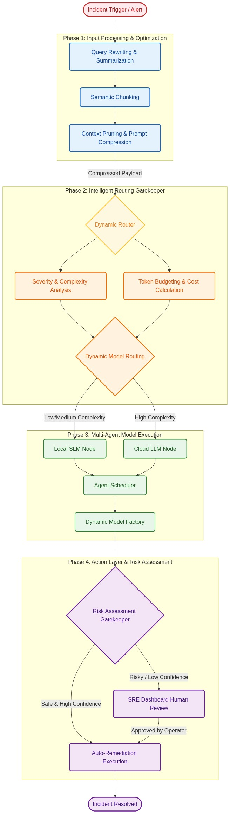
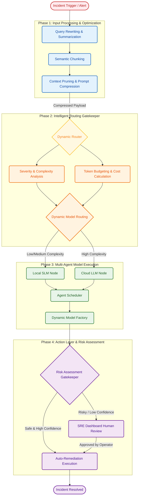

# Self-Healing Token-Aware Multi-Agent Architecture

This document contains the visual architecture diagram for the Self-Healing Token-Aware Multi-Agent SRE Architecture.

## Architecture Diagram

