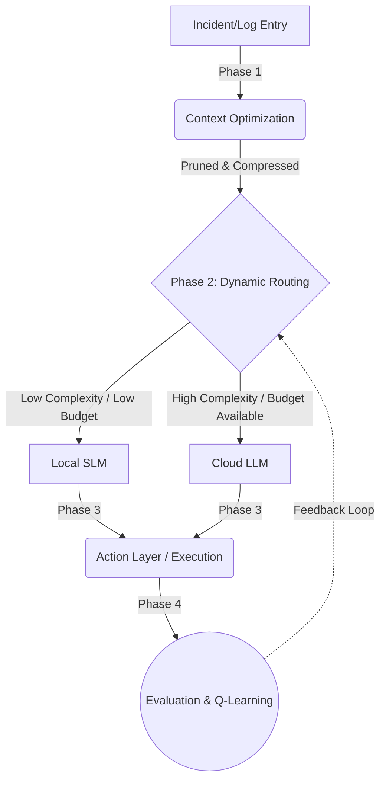

# Token-Aware Multi-Agent Architecture

> [!WARNING]
> **Phase 5 (Continuous Fine-Tuning) is NOT implemented in the current codebase.** The architectural plan references a fifth phase utilizing QLoRA for the local SLM and SFT for the BERT classifier, but this functionality is entirely absent from the repository.

## Architecture Overview

The system processes SRE incidents through a multi-phase pipeline designed to minimize token usage and optimize routing between free Local Small Language Models (SLMs) and paid Cloud Large Language Models (LLMs).

## Phase 1: Context Optimization (`src/optimization/`)
Reduces the payload size before inference to save API costs.
- **`pruner.py`**: Utilizes `all-MiniLM-L6-v2` embeddings for semantic similarity pruning.
- **`compressor.py`**: Utilizes `LLMLingua` / TinyLlama to remove stopwords.

> [!TIP]
> **Performance Recommendation:** Compression should be conditionally bypassed for short payloads to reduce inference latency, as LLMLingua introduces significant processing time overhead.

## Phase 2: Dynamic Routing (`src/router/`)
Determines the optimal execution model.
- **`classifier.py`**: Uses `cross-encoder/nli-distilroberta-base` to determine Severity and Complexity.
- **`budgeting.py`**: Calculates allowed token budget based on severity.
- **`dynamic_router.py`**: Orchestrates routing decisions.

> [!CAUTION]
> **Critical Disconnect:** Currently, `dynamic_router.py` bypasses the Phase 4 Q-Learning system and relies entirely on hardcoded complexity thresholds (e.g., `complexity >= 7`).

## Phase 3: Execution (`src/execution/` & `src/action_layer/`)
Executes the prompt against the designated LLM/SLM and validates the output.
- **`model_factory.py`**: LangChain wrappers for Cloud/Local APIs.
- **`agent_scheduler.py`**: Dynamically injects SRE personas based on keyword analysis.
- **`risk_assessor.py`**: Safety regex failsafe against destructive bash commands.

## Phase 4: Continuous Learning (`src/evaluation/`)
Tabular Q-Learning engine intended to shift trust to the local SLM over time.
- **`q_learning.py`**: Updates the Q-Table based on reward feedback from successful bash executions.

## Phase 5: Continuous Fine-Tuning (Missing)
- **Status:** Not implemented.
- **Expected Functionality:** Supervised Fine-Tuning (SFT) for the BERT classifier and QLoRA adaptation for the local SLM using historical execution data.
